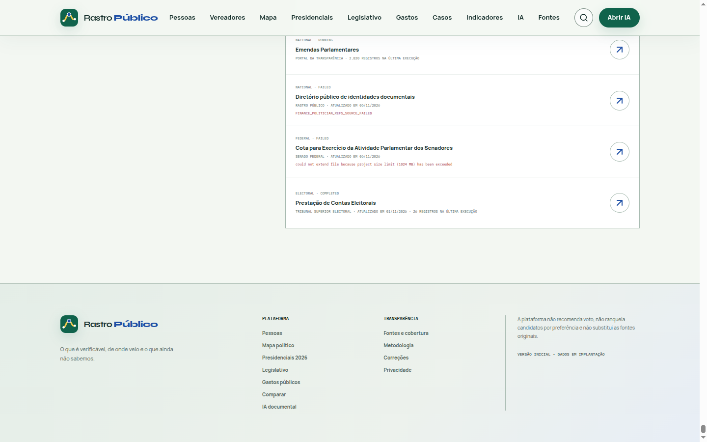

# Rastro Público

> **Where does public money go?** An independent, non-partisan open-source platform to
> search, understand and investigate Brazilian public spending: natural-language search,
> procurement dashboards, price comparison across equivalent purchases, and a
> deterministic audit engine that flags anomalies for **human review**, never as proof of
> wrongdoing. Data comes from official public sources (PNCP, Comprasnet, TCE-SP) and keeps
> a link to the original record. Next.js + FastAPI + PostgreSQL, runnable with Docker
> Compose.

> ⚠️ Rastro Público **is not an official government service**. All data comes from official
> public sources and keeps the link to the original record.

> The product interface, data labels and the source documents are in Brazilian Portuguese,
> because the data and the audience are Brazilian.

---

| | |
|:--|:--|
| **Live demo** | [rastro-publico.vercel.app](https://rastro-publico.vercel.app) |
| **Screenshots** | [`docs/screenshots`](docs/screenshots) — home, spending dashboard, published records table |
| **CI** | [](https://github.com/FelipeFeerreira/rastro-publico/actions/workflows/ci.yml) |
| **Stack** | FastAPI · Python · Next.js · TypeScript · PostgreSQL · Docker Compose |
| **License** | MIT — [LICENSE](LICENSE) |

## Screenshots

Real captures of the deployed app (November 6, 2026), Brazilian Portuguese interface because the data and the audience are Brazilian.

| Home | Spending dashboard |
| --- | --- |
|  |  |



**Known performance issue:** the home page takes ~7.2 s to first byte (measured 7.21 s, 7.23 s, 7.40 s and 7.48 s on four consecutive requests; a static asset on the same deployment answers in 0.34 s). Every request comes back `x-vercel-cache: MISS` with `cache-control: private, no-store`, so the page is rendered on each visit and the render waits on the Python API — not a cold start, since the fourth request is as slow as the first.


## Contents

- [Overview](#overview)
- [Architecture](#architecture)
- [Stack](#stack)
- [Quick start with Docker](#quick-start-with-docker)
- [Local development](#local-development)
- [Ingesting real data](#ingesting-real-data)
- [Tests](#tests)
- [Project structure](#project-structure)
- [Principles](#principles)
- [Documentation](#documentation)

---

## Overview

Rastro Público offers two integrated experiences:

1. **Simple search** — any citizen can search spending, contracts, suppliers, agencies and
   items in natural language, with autocomplete, filters and grouped results.
2. **Automated investigation** — the system compares prices across equivalent purchases,
   detects statistical anomalies in an explainable way and organises evidence for
   citizen reports.

The first real integration is the **National Public Procurement Portal (PNCP)**, covering
procurement under Law 14.133/2021 at federal, state and municipal level.

### Municipal dashboard

There is a municipal spending dashboard at `/municipios/3545209/despesas` (**Salto/SP**),
sourced from TCE-SP: how much the City Hall, the City Council and SAAE **actually paid**,
alongside committed, settled and cancelled amounts (always kept separate, never added
together), with filters by year, month, institution, supplier and stage. **Paid** is the
primary metric. Partial coverage is stated explicitly (e.g. 2026: Jan–Aug). Municipal
spending is kept separate from the federal spending of IFSP Campus Salto.

### Campus dashboard

There is a dashboard per management unit (UASG) at `/campus/{uasg}` — for example
`/campus/158364` (**IFSP Campus Salto**). In plain language it gathers what was contracted,
suppliers, period, amounts and how much was **actually paid**, with filters by date,
supplier and amount. **Federal** spending (IFSP) is kept separate from the **municipal**
spending of Salto. Reachable from the home page and from search results.

## Architecture

A modular monolith with clear boundaries:

```
frontend/  Next.js (App Router, TypeScript, Tailwind, shadcn/ui, Recharts)
backend/   FastAPI + SQLAlchemy + Alembic + Pydantic
  ├── connectors/   public data connectors (PNCP, ...)
  ├── services/     ingestion, normalisation, search, analysis, AI, reports
  ├── models/       normalised PostgreSQL schema
  └── api/          versioned REST endpoints
postgres/  relational database with full-text search
redis/     rate-limit cache and async tasks (optional)
```

Details in [`ARCHITECTURE.md`](./ARCHITECTURE.md).

## Stack

| Layer      | Technology |
|------------|------------|
| Frontend   | Next.js 15 (App Router), TypeScript, Tailwind CSS, shadcn/ui, Lucide, Recharts |
| Backend    | Python 3.11+, FastAPI, SQLAlchemy 2.0, Alembic, Pydantic v2 |
| Database   | PostgreSQL 16 (full-text search with `portuguese`) |
| Async      | Redis + Celery (optional) |
| Infra      | Docker, Docker Compose, GitHub Actions |
| Tests      | pytest, respx, Vitest, Testing Library, Playwright |

## Quick start with Docker

```bash
cp .env.example .env
# edit .env if needed (ports, secrets)
docker compose up -d --build
```

- Frontend: http://localhost:3000
- API: http://localhost:8000/api/v1
- API docs (Swagger): http://localhost:8000/api/docs

Sync a small sample of real PNCP data:

```bash
docker compose exec api python -m app.cli seed
docker compose exec api python -m app.cli ingest pncp \
  --data-inicial 2026-01-05 --data-final 2026-01-05 \
  --modalidades 6 --max-paginas 1
```

## Local development

### Backend

```bash
cd backend
python -m venv .venv && source .venv/bin/activate
pip install -e ".[dev]"
alembic upgrade head
python -m app.cli seed
uvicorn app.main:app --reload
```

### Frontend

```bash
cd frontend
cp .env.example .env.local   # adjust NEXT_PUBLIC_API_BASE_URL
npm install
npm run dev
```

## Ingesting real data

The PNCP connector implements pagination, rate limiting, retries with exponential backoff
and deduplication by PNCP control number.

```bash
# Procurement by period and modality (Law 14.133/2021 codes)
python -m app.cli ingest pncp --data-inicial 2026-01-01 --data-final 2026-01-31 \
  --uf SP --modalidades 6,5 --max-paginas 5

# Include items and approved results (slower at the source)
python -m app.cli ingest pncp --data-inicial 2026-01-05 --data-final 2026-01-05 \
  --com-itens --max-paginas 1

# Contracts (PNCP)
python -m app.cli contracts --data-inicial 2026-01-01 --data-final 2026-01-31

# Federal Comprasnet contracts per management unit (UASG)
# E.g. IFSP Campus Salto — UASG 158364, Salto/SP (IBGE 3545209)
python -m app.cli comprasnet --uasg 158364 \
  --municipio 3545209 --nome-municipio Salto --uf SP

# Financial execution (committed/settled/paid) of a UASG's contracts
python -m app.cli comprasnet-pagamentos --uasg 158364

# Municipal spending (events) from TCE-SP — e.g. Salto/SP
python -m app.cli tce-sp-despesas --municipio salto --ibge 3545209 --uf SP \
  --nome-municipio Salto --ano 2025 --mes-inicio 1 --mes-fim 12

# Enrichment: history, function/activity and official detail link
# (TCE-SP dataset CSV; 1:1 matching, idempotent)
python -m app.cli tce-sp-detalhes --municipio salto --ibge 3545209 --ano 2025 --max 100

# Federal civil-servant pay (requires TRANSPARENCIA_API_KEY)
python -m app.cli transparencia-servidores --orgao 26439 --mes 202501 \
  --campus "IFSP - CAMPUS SALTO"

# Run the audit engine
python -m app.cli audit --limit 200
```

> **Payments:** the stages stay separate — "empenhado" commits, "liquidado" verifies and
> "pago" settles. A contracted amount is never displayed as paid.
> **Salaries:** shown only when officially published; without the Transparency Portal
> credential the platform states the unavailability explicitly.

> The Comprasnet import is idempotent (re-importing updates, never duplicates) and
> validates each record's UASG, so contracts from other campuses are never misattributed.

> Collection is **incremental**: existing records are updated, not duplicated. Each run
> produces a `collection_run` with counters and an error log.

## Tests

```bash
# Backend
cd backend && python -m pytest -q        # 37 tests
ruff check app tests

# Frontend
cd frontend && npm run test              # Vitest
npm run typecheck && npm run lint
npm run test:e2e                         # Playwright (requires the stack running)
```

## Project structure

```
politica/
├── ARCHITECTURE.md          # architecture decisions and data model
├── ROADMAP.md               # milestones and status
├── docker-compose.yml
├── .env.example
├── backend/
│   ├── app/
│   │   ├── core/            # config, logging, security, rate limit
│   │   ├── db/              # engine, session, declarative base
│   │   ├── models/          # 26 normalised tables
│   │   ├── schemas/         # Pydantic contracts
│   │   ├── connectors/      # PNCP and connector infrastructure
│   │   ├── services/        # ingestion, normalisation, search, analysis, AI
│   │   ├── api/v1/          # REST endpoints
│   │   ├── cli.py           # seed, ingest, audit, stats
│   │   └── main.py
│   ├── alembic/             # migrations
│   └── tests/               # pytest
└── frontend/
    └── src/
        ├── app/             # routes (App Router)
        ├── components/      # UI, layout, search, charts, investigation
        └── lib/             # api, types, formatting
```

## Principles

1. **Never invent data.** Production figures come exclusively from official sources.
2. **Full traceability.** Every number points back to the original record and source.
3. **Distinct financial stages.** Estimated ≠ approved ≠ committed ≠ paid.
4. **An anomaly is not an accusation.** The platform flags; the conclusion belongs to the
   competent authorities and to the citizen.
5. **The AI does not compute values.** Calculation is deterministic; the AI explains and
   organises.
6. **Political neutrality.** No corruption ranking and no automatic verdict.

## Documentation

- [`ARCHITECTURE.md`](./ARCHITECTURE.md) — architecture, data model and the PNCP connector
- [`ROADMAP.md`](./ROADMAP.md) — milestones and checklist
- [`docs/API.md`](./docs/API.md) — API reference
- [`docs/DEPLOYMENT.md`](./docs/DEPLOYMENT.md) — deployment and operation
- [`docs/DATA_SOURCES.md`](./docs/DATA_SOURCES.md) — sources and requirements

## What I would do next

- Expand the ingestion connectors and document coverage per source in the ROADMAP.
- Capture the municipal dashboard and the audit engine screens for the top of this README.
- Add an end-to-end test that ingests a known fixture and asserts the reported totals.

## Licence and responsible use

Code under the MIT licence — see [LICENSE](LICENSE).

A public-interest platform. When reusing the data, cite the official source and Rastro
Público. Do not present automated findings as proof of wrongdoing.
